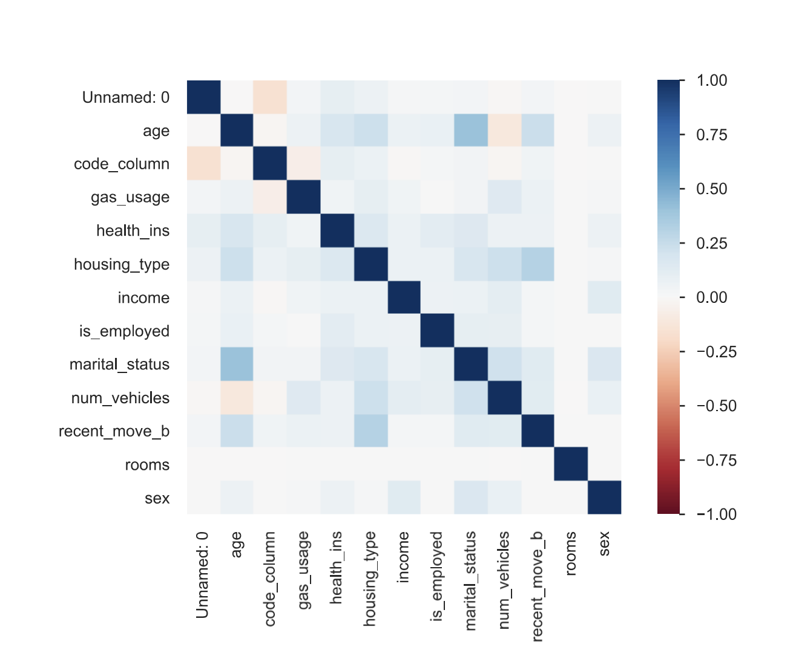

# 1. Data-Centric AI & Data Profiling

> Individual assignment · [Notebook](https://franciscopana.github.io/M.IA_Artificial-Intelligence-Society/01-data-profiling/notebook.html) · [Report (PDF)](report.pdf) · [← Back to overview](../README.md)

**Goal:** audit the quality of a real-world **Health Insurance dataset** before any model is trained. The dataset has 72,458 customers and 15 socio-economic and demographic features. The binary target `health_ins` says whether a customer has health insurance.

## Method
The dataset was profiled feature by feature with **YData Profiling**, alongside manual exploration in Pandas and Seaborn. Each quality issue is documented with its consequence and a proposed fix.

## Findings

| Issue | Evidence | Risk |
| :--- | :--- | :--- |
| **Unique identifiers** | `Unnamed: 0` and `custid` are per-record IDs | No predictive value; adds noise and overfitting |
| **Missing data** | `is_employed` is **32% missing**. A further 1,687 rows (2.3%) are missing `housing_type`, `num_vehicles`, `gas_usage` and `recent_move_b` together | Biased estimates if dropped or imputed carelessly |
| **Outliers** | Ages of **0** and up to **120**; **negative incomes** (range −6,900 to 1.26M) | Invalid records distort scaling and models |
| **Target imbalance** | **90.5%** of customers are insured | A classifier can look accurate by always predicting the majority class |
| **Relationships** | Weak correlations overall; notable links `marital_status` ↔ `age` and `housing_type` ↔ `recent_move` | Few strong individual predictors |

## Takeaway
The data had several issues that would quietly bias any model: identifier leakage, structured missingness, invalid values and a 10:1 class imbalance. These findings set the agenda for [Assignment 2](../02-data-complexity/) and [Assignment 3](../03-imbalanced-learning/).

## Files
| File | Content |
| :--- | :--- |
| `notebook.html` | Rendered Jupyter notebook ([view online](https://franciscopana.github.io/M.IA_Artificial-Intelligence-Society/01-data-profiling/notebook.html)) |
| `report.pdf` | Two-page report |
| `figures/` | Profiling screenshots: `features/` (one per variable), `correlations/`, alerts, missing values |
