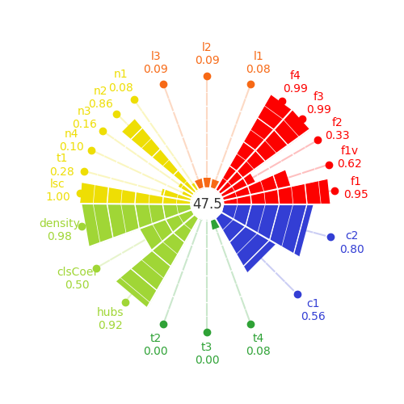

# 2. Data Complexity & Meta-Learning

> Individual assignment · [Notebook](https://franciscopana.github.io/M.IA_Artificial-Intelligence-Society/02-data-complexity/notebook.html) · [Report (PDF)](report.pdf) · [← Back to overview](../README.md)

**Goal:** measure *how hard* the health-insurance classification problem is with data complexity measures, and relate them to how different learning paradigms behave.

## Method
After removing identifiers and incomplete rows (70,771 instances, 12 features), the full **[problexity](https://github.com/w4k2/problexity)** suite of 22 measures was computed. It covers six families: feature-based, linearity, dimensionality, class imbalance, neighbourhood and network.

- **Scalability workaround:** neighbourhood and network measures rely on pairwise distances and graph construction, which was infeasible at 70k rows. A **10% stratified sample** was used for them instead. The measures shared with the full dataset confirmed that the sample preserved them (e.g. F1 0.947 vs 0.954, L2 0.091 vs 0.091, C2 0.802 vs 0.802).
- **Dimensionality:** PCA shows that a **single component** explains 95% of the variance (T4 = 0.083).

| Family | Key measures |
| :--- | :--- |
| Feature-based | F1 = 0.947, F2 = 0.289, F3 = 0.994, F4 = 0.994 |
| Linearity | L1 = 0.083, L2 = 0.091, L3 = 0.091 |
| Neighbourhood | N1 = 0.079, N2 = 0.860, N3 = 0.158, LSC = 0.997 |
| Network | Density = 0.979, ClsCoef = 0.502, Hubs = 0.924 |
| Class imbalance | C1 = 0.561, C2 = 0.802 |

## Benchmarking learning paradigms
Three classical paradigms were benchmarked with hyperparameter sweeps on an 80/20 stratified split:

| Model | Accuracy | F1-score | Fit/predict time (s) |
| :--- | :--- | :--- | :--- |
| **Decision Tree** (max_depth = 5) | **0.909** | **0.952** | 0.14 |
| Logistic Regression (C = 1) | 0.909 | 0.952 | **0.03** |
| KNN (k = 19) | 0.908 | 0.952 | 6.48 |

All three converged to nearly identical scores. As [Assignment 3](../03-imbalanced-learning/) shows, this is exactly the **majority-class rate (90.9%)**.

## Open-source contribution
While studying the T2 measure, I found that its name ("features per dimension") did not match its formula (features ÷ instances). I reported this upstream in [problexity issue #9](https://github.com/w4k2/problexity/issues/9).

## Retrospective note
problexity normalises every measure so that values near **0 mean a simple problem and values near 1 a complex one**. The high F1/F3/F4, LSC, density and hubs values therefore point to a *hard* problem with weak individual features, not to strong separability. In the same way, L2 = 0.091 matches the minority-class share, which means the internal linear classifier simply predicted the majority class.

## Files
| File | Content |
| :--- | :--- |
| `notebook.html` | Rendered Jupyter notebook ([view online](https://franciscopana.github.io/M.IA_Artificial-Intelligence-Society/02-data-complexity/notebook.html)) |
| `report.pdf` | Two-page report |
| `figures/` | Complexity plot and screenshot of the problexity issue |
