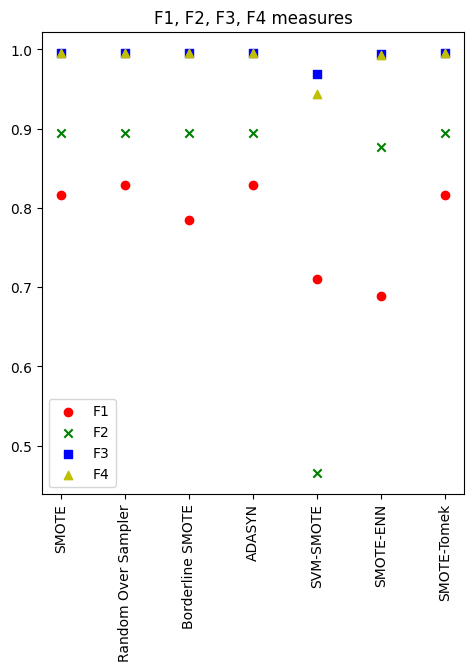
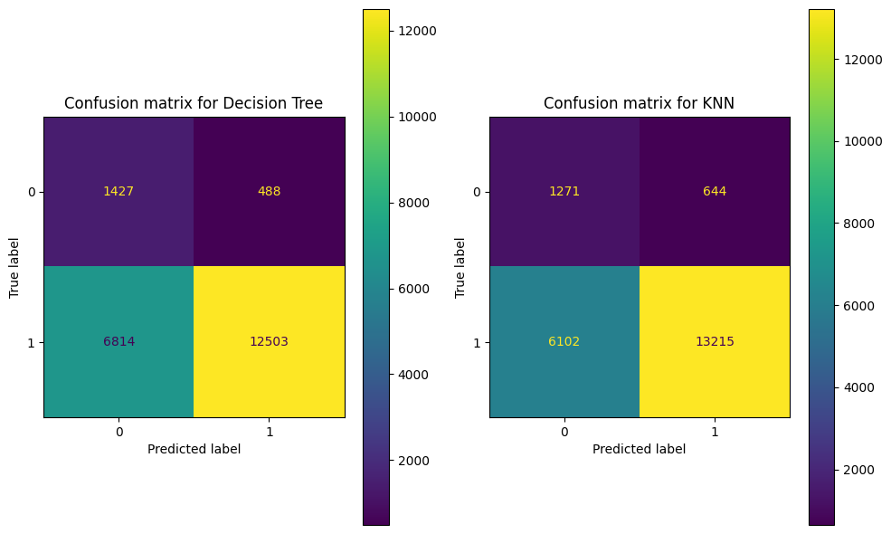

# 3. Imbalanced Learning

> Individual assignment · [Notebook](https://franciscopana.github.io/M.IA_Artificial-Intelligence-Society/03-imbalanced-learning/notebook.html) · [Report (PDF)](report.pdf) · [← Back to overview](../README.md)

**Goal:** show why accuracy and F1 were misleading on the health-insurance problem, then rebalance the data and choose a resampling strategy objectively, using data complexity measures.

## Preprocessing
- Missing `is_employed` values are treated as *not in the workforce*.
- The redundant `code_column` (a 1:1 encoding of `state_of_res`) is dropped.
- `age` is clipped to [21, 99] and min-max scaled.
- Right-skewed `income` and `gas_usage` are log-transformed.
- `housing_type` is merged into *owner* vs *non-owner*.
- Categorical features are label/one-hot encoded.

## Exposing the problem
With an imbalance ratio of **~10:1**, the "best" models from Assignment 2 reach 91% accuracy and 95% F1 while detecting almost none of the uninsured customers:

| Model (imbalanced training data) | Accuracy | F1-score | Specificity |
| :--- | :--- | :--- | :--- |
| Decision Tree (max_depth = 5) | 0.910 | 0.953 | **0.0%** |
| Decision Tree (unlimited depth) | 0.846 | 0.915 | 22.0% |
| KNN (k = 20) | 0.910 | 0.953 | 2.7% |
| KNN (k = 2) | 0.815 | 0.895 | **30.8%** |

Deeper trees and fewer neighbours look *worse* on paper, yet they were the only configurations that captured the minority class.

## Rebalancing
Seven resampling strategies from **imbalanced-learn** were applied to the training set only, to avoid leakage: **SMOTE**, **Random Oversampling**, **Borderline-SMOTE**, **ADASYN**, **SVM-SMOTE**, **SMOTE-ENN** and **SMOTE-Tomek Links**.

Instead of picking one by trial and error, each resampled dataset was scored with the feature-based complexity measures from [Assignment 2](../02-data-complexity/). **SVM-SMOTE** had by far the lowest feature overlap (F2 = 0.466 vs ~0.89 for the other methods) and the lowest F3/F4.

## Re-evaluation
After rebalancing, both models could genuinely identify uninsured customers:

| Model (rebalanced training data) | Accuracy | Precision | Recall | F1-score | Specificity | G-Mean |
| :--- | :--- | :--- | :--- | :--- | :--- | :--- |
| **Decision Tree** (max_depth = 5) | 0.656 | **0.962** | 0.647 | 0.774 | **0.745** | **0.694** |
| KNN (k = 21) | **0.682** | 0.954 | **0.684** | **0.797** | 0.664 | 0.674 |

## Takeaways
- **Accuracy can lie.** On a 10:1 problem, predicting "insured" for everyone scores 91% accuracy and 95% F1. Specificity, G-Mean and confusion matrices showed the real behaviour.
- **Specificity went from 0% to ~75%.** The drop in headline accuracy was a trade-off against a number that had never reflected real performance.
- **Complexity measures work as a selection tool,** giving an objective way to choose a resampling strategy before training any model.

## Retrospective note
The notebook's re-evaluation cell trains on `X_smote, y_smote` (standard SMOTE), although the text selects SVM-SMOTE. The SVM-SMOTE choice itself still holds under problexity's "0 = simple, 1 = complex" scale, since it has the lowest F2, F3 and F4.

## Files
| File | Content |
| :--- | :--- |
| `notebook.html` | Rendered Jupyter notebook ([view online](https://franciscopana.github.io/M.IA_Artificial-Intelligence-Society/03-imbalanced-learning/notebook.html)) |
| `report.pdf` | Two-page report |
| `figures/` | Specificity sweep, resampling complexity comparison, confusion matrices |
