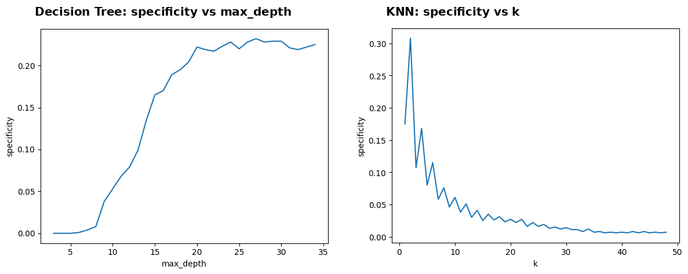

# Artificial Intelligence and Society: Data-Centric & Responsible AI

### ▶ [Open the project website](https://franciscopana.github.io/M.IA_Artificial-Intelligence-Society/)
The website shows every notebook rendered, plus the reports. On github.com the `.html` notebooks only show as source code.

> Course unit: [Inteligência Artificial e Sociedade](https://sigarra.up.pt/feup/pt/ucurr_geral.ficha_uc_view?pv_ocorrencia_id=542585) (Artificial Intelligence and Society)
> <br />
> **MSc in Artificial Intelligence** · FCUP / FEUP, University of Porto
> <br />
> Final grade: **17**/20

---

## Overview
This repository collects the work for one course unit about the data, evaluation and fairness risks of real-world AI systems. It has two threads, both built on insurance data:

- **Data-centric AI (individual, assignments 1-3).** A single case study on a **health-insurance dataset** (72,458 customers, binary target `health_ins`). It moves from auditing data quality, to measuring problem complexity, to showing that a "91% accurate" model was blind to the minority class, and then fixing it.
- **Algorithmic fairness (group, project 4).** A study of **discrimination in car-insurance pricing**: how insurers kept penalising Black neighbourhoods through proxy variables after Michigan's 2019 reform, plus a bias analysis of Allstate's rate data with fairness metrics and SHAP.

## Projects

| # | Project | Type | Focus | Notebook | Report | Details |
| :-: | :--- | :--- | :--- | :-: | :-: | :-: |
| 1 | **Data-Centric AI & Data Profiling** | Individual | Data quality audit: missing data, outliers, ID leakage, imbalance | [view](https://franciscopana.github.io/M.IA_Artificial-Intelligence-Society/01-data-profiling/notebook.html) | [PDF](01-data-profiling/report.pdf) | [README](01-data-profiling/) |
| 2 | **Data Complexity & Meta-Learning** | Individual | 22 complexity measures (problexity), paradigm benchmark | [view](https://franciscopana.github.io/M.IA_Artificial-Intelligence-Society/02-data-complexity/notebook.html) | [PDF](02-data-complexity/report.pdf) | [README](02-data-complexity/) |
| 3 | **Imbalanced Learning** | Individual | Misleading metrics, 7 resampling strategies, complexity-guided selection | [view](https://franciscopana.github.io/M.IA_Artificial-Intelligence-Society/03-imbalanced-learning/notebook.html) | [PDF](03-imbalanced-learning/report.pdf) | [README](03-imbalanced-learning/) |
| 4 | **Algorithmic Discrimination in Car Insurance** | Group (6) | Proxy discrimination, disparate impact, subgroup analysis, SHAP | — | [PDF](04-fairness-car-insurance/report.pdf) | [README](04-fairness-car-insurance/) |

## Main findings
- **Data first.** The health-insurance data had identifier leakage, 32% missing values in one feature, invalid ages and incomes, and a 10:1 class imbalance. Most of the later progress came from fixing these, not from changing the algorithm.
- **Accuracy can lie.** Decision Tree, Logistic Regression and KNN all reached ~91% accuracy and 95% F1, which is exactly the majority-class rate. Their specificity was **0-3%**.
- **Better evaluation, better models.** Evaluating with specificity, G-Mean and confusion matrices, and rebalancing the training data, raised minority-class specificity from **0% to ~75%**.
- **Complexity measures as a selection tool.** Feature-overlap measures picked SVM-SMOTE among 7 resampling methods before any model was trained.
- **Fairness through proxies.** Banning protected attributes was not enough. Territory grids and "insurance scores" carried the same bias, and in Allstate's data the median premium rose with an area's share of Black residents, even though SHAP showed no direct effect of race, gender or age.
- **Open source.** A naming/formula inconsistency in problexity's T2 measure was reported upstream in [issue #9](https://github.com/w4k2/problexity/issues/9).



## Repository structure
```text
M.IA_Artificial-Intelligence-Society/
├── index.html                    # Landing page (served by GitHub Pages)
├── 01-data-profiling/            # Assignment 1
│   ├── README.md                 #   summary, findings, figures
│   ├── notebook.html             #   rendered Jupyter notebook
│   ├── report.pdf                #   two-page report
│   └── figures/
├── 02-data-complexity/           # Assignment 2 (same layout)
├── 03-imbalanced-learning/       # Assignment 3 (same layout)
└── 04-fairness-car-insurance/    # Group project: README.md + report.pdf
```

## How to view
- **Online:** [franciscopana.github.io/M.IA_Artificial-Intelligence-Society](https://franciscopana.github.io/M.IA_Artificial-Intelligence-Society/)
- **Locally:**
  ```bash
  git clone https://github.com/franciscopana/M.IA_Artificial-Intelligence-Society.git
  cd M.IA_Artificial-Intelligence-Society
  python -m http.server 5501   # then open http://localhost:5501
  ```

To reproduce assignments 1-3, the Health Insurance dataset (`data.csv`) is in the [Introduction to Data Science](https://github.com/franciscopana/M.IA_Intro-Data-Science) repository, which extends this case study into a full prediction pipeline.

```bash
pip install pandas numpy matplotlib seaborn ydata-profiling problexity scikit-learn imbalanced-learn
```

## Tech stack
Python, Pandas, NumPy, Scikit-learn, Imbalanced-learn, Problexity, YData Profiling, SHAP, Matplotlib, Seaborn, Jupyter.
Methods: data profiling, data complexity measures, resampling (SMOTE family), imbalanced-classification metrics (specificity, G-Mean), fairness metrics (disparate impact), regression diagnostics, explainability (SHAP).

## Authors
- **Francisco da Ana** (up202108762): assignments 1-3 (individual).
- Project 4 (group): Adriano Machado, André Silva, Cristiano Rocha, Francisco da Ana, Gonçalo Santos, João Lima.
